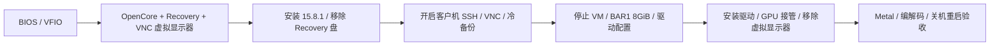

# Unraid 上的 macOS 15.8.1 + RTX 3060 直通

> **远程桌面推荐：[GlideBeam / 光梭](https://github.com/dixtdf/GlideBeam)** 是我们新开发的 Windows 到 Mac 局域网远控软件，可临时替代延迟高、体验不佳的 VNC / RustDesk。它采用 H.264 硬件编解码，并支持剪贴板共享和文件传输。当前面向已登录的 Mac 桌面，建议保留 SSH / VNC 作为登录前操作和故障救援入口。

一份基于实际安装过程整理的中文教程：在 Unraid / QEMU 中安装 macOS Sequoia 15.8.1，再使用 [NullMoth NVIDIA 驱动](https://github.com/nullmoth/nvidia-macos-driver/releases/tag/v1.9.0) 驱动 RTX 3060 12GB，保留远程访问，并修复关机后 QEMU 不退出的问题。

初装记录来自 2026-10-09 的 NullMoth 1.1.0；2026-10-11 已升级并验收 **NullMoth 1.9.0、OpenCore 1.0.5、macOS 15.8.1（24H32）**，见[升级过程](docs/09-driver-upgrade-1.9.0.md)与[新实测摘要](results/observed-2026-10-11-1.9.0.json)。[原始 1.1.0 实测](results/observed-2026-10-09.json)保留为历史基线。本仓库是安装记录和配置工具，不是 NVIDIA 驱动项目。

**v1.10.0 兼容性注意：**上游不再给 RTX 3060 注册 H.264 / HEVC 硬编码器。当前 GlideBeam 强制硬编，升级会影响其远程画面；先读 [1.10.0 审查说明](docs/10-driver-upgrade-1.10.0.md)，不要只按版本号自动升级。

**给 AI 使用：**先读根目录 [AGENTS.md](AGENTS.md)，再读 [AI 教材](docs/AI-GUIDE.md)和[机器索引](ai/knowledge.json)。教材末尾提供本地 / GitHub 阅读提示，可直接复制给接手的 AI。

## 1.9.0 实测结果

| 项目 | 结果 | 范围 |
| --- | --- | --- |
| PCI 直通 | 通过 | RTX 3060 显卡和 HDMI 音频功能同时直通 |
| 显卡识别 | 12GB、Metal 3 | 系统报告和原生 Metal 设备枚举 |
| Metal | 通过 | 小缓冲区复制、运行时编译计算、64×64 渲染 |
| H.264 硬件编码 / 解码 | 通过 | 1280×720、30fps、30 帧，验证解码后的像素 |
| HEVC / H.265 硬件解码 | 通过 | 解码 Apple 软件编码产生的短片段 |
| HEVC / H.265 硬件编码 | **未通过** | API 返回成功，但解码后的画面错误 |
| 远程桌面 | macOS 自带 VNC 可用 | 认证并读取 1920×1080 登录画面；本轮未重测 GlideBeam 登录后会话 |
| 关机 / 重启 | 通过 | `-vsmccomp` 消除双 AppleSMC；关机使 QEMU 正常退出 |
| CPU | 10 核 20 线程可用 | ES 处理器的显示名称仍为 Unknown；部分 CPUID 信息显示 16/32 |

这些结果只覆盖下面这台机器和小规模验收，不能推导出所有 RTX 型号、应用、长时间负载或新版驱动都可用。RustDesk 的硬件编码能力还受客户端实现和 VideoToolbox 属性查询影响，不能仅凭“Metal 3”判断。

## 测试环境

| 组件 | 实际版本 / 配置 |
| --- | --- |
| 主板 / BIOS | ASRock B460M Pro4S/ac / P1.40 |
| CPU | Intel i9-10900K ES QTB2，10 核 20 线程 |
| GPU | RTX 3060 12GB，PCI ID `10de:2504`；音频 `10de:228e` |
| Unraid / 内核 | 7.3.2 / Linux 6.18.38 |
| QEMU / libvirt | 10.2.3 / 12.2.0 |
| 虚拟机 | Q35、OVMF pure EFI、16GiB 内存、20 vCPU、160GiB qcow2 |
| 显示器 | 显卡连接物理显示器；未验证 HDMI 假负载方案 |
| BIOS | Above 4G Decoding 已开启；没有找到 C.A.M. / Re-Size BAR 菜单 |
| BAR1 | 宿主机由 256MiB 调整到 8GiB，再启动虚拟机 |

## 按顺序安装

1. [准备硬件、BIOS、VFIO 和依赖](docs/01-prerequisites.md)。
2. [生成自己的 SMBIOS 身份和 OpenCore 配置](docs/03-opencore-and-identity.md)。这一步在首次开机前完成，以后保持身份不变。
3. [准备精确版本安装介质，安装 macOS](docs/02-installation.md)。
4. [调整 BAR、安装驱动、移除虚拟显示器](docs/04-gpu-driver-and-bar.md)。
5. [配置 VNC，验证关机和重启](docs/05-remote-and-power.md)。
6. [运行 Metal 和视频验收，排查常见问题](docs/06-validation-and-troubleshooting.md)。
7. [建立恢复点、回滚和发布 GitHub 仓库](docs/07-backup-and-publishing.md)。

已有 VM 升级时先读 [1.1.0 → 1.9.0](docs/09-driver-upgrade-1.9.0.md)；计划使用 1.10.0 时先核对[硬编码变化](docs/10-driver-upgrade-1.10.0.md)。

总体流程：

## 仓库内容

- `templates/`：从工作配置脱敏而来的 OpenCore 1.0.5 和 libvirt 模板，身份字段留空，Apple SMC OSK 使用占位符。
- `tools/configure.py`：生成本地身份配置，输出安装阶段或显卡阶段的 OpenCore / XML；不会连接服务器或修改运行中的 VM。
- `tools/check_publication.py`：检查待发布文件中的介质、私网 IP、已填身份、OSK、密码字段等。
- `scripts/unraid/`：建立 EFI 镜像、调整 BAR、VM 启动钩子、冷备份。
- `scripts/macos/`：基本验收和原生测试的编译入口。
- `tests/native/`：实际使用的 Metal / VideoToolbox 测试源码。
- `results/`：脱敏实测结论；不附原始私有日志。
- `AGENTS.md`、`docs/AI-GUIDE.md`、`ai/knowledge.json`：AI 阅读入口、教材和任务索引。

文档描述的硬件流程已在实机执行。导出的通用脚本经过离线测试和语法检查，**没有作为一套全自动安装器在另一台服务器完整重跑**。先阅读脚本的参数和前置条件，再在自己的机器执行。

本次文件与工具的具体检查范围见[导出检查记录](docs/08-export-validation.md)。

## 下载与授权

安装介质、EFI 二进制、驱动、固件和身份参数由使用者自行取得，不随本仓库分发。原始文档、辅助脚本和测试源码采用 [MIT License](LICENSE)；配置模板的来源和第三方许可证见 [NOTICE](NOTICE.md)。教程的 EFI 基础来自 [LongQT-sea/OpenCore-ISO](https://github.com/LongQT-sea/OpenCore-ISO)。

本仓库只在本地生成配置。真实序列号、MLB、UUID、ROM、MAC、密码和 OSK 放在被忽略的 `local/` 中。发布前请按[发布步骤](docs/07-backup-and-publishing.md)运行检查。
