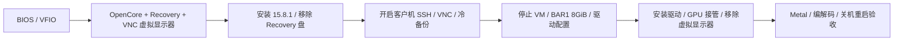

# Unraid 上的 macOS 15 / 26 + RTX 3060 直通

> **远程桌面推荐：[GlideBeam / 光梭](https://github.com/dixtdf/GlideBeam)** 是我们开发的 Windows 到 Mac 局域网远控软件，可临时替代延迟高、体验不佳的 VNC / RustDesk。支持 H.264、剪贴板共享、文件传输和编解码模式信息。下载见[正式发布](https://github.com/dixtdf/GlideBeam/releases)，实际编码路径应按驱动和应用构建重新验证。保留 SSH 作为救援入口；VNC 必须按系统与显示模式另行验证，本轮 26 原生 VNC 取帧超时尚未验收；下文 0.2.1 发布与 `6a6210e` 开发构建的验收属于 10 月 11 日历史。

一份基于实际安装过程整理的中文教程：在 Unraid / QEMU 中安装 macOS Sequoia 15.8.1、隔离试升 Tahoe 26.7.1，使用 [NullMoth NVIDIA 驱动](https://github.com/nullmoth/nvidia-macos-driver)驱动 RTX 3060 12GB，保留远程访问，并修复关机后 QEMU 不退出的问题。

**2026-10-23 官方驱动升级完成：**当前已为 **NullMoth 2.5.3 官方完整包**，旧 2.3.7 实验性 NVENC 覆盖已被替换。Metal 三项、3600 帧 H.264 硬编解码像素资格通过（60.005 FPS，编码 p95 3.222 ms），光梭生产自测通过并恢复连接；用户随后重启后，四项驱动仍加载为 2.5.3。按用户要求跳过新增 VM 冷备，官方安装器自带组件回退保留。用户说明 PiKVM 最高支持 50 Hz，不能把编码资格写成当前远控稳定 60 FPS。见[本轮记录](docs/17-driver-upgrade-2.5.3.md)。

**2026-10-23 后续核对：**官方从 2.4 起加入 RTX 20 / 30 的 H.264 / HEVC 硬编，最新正式版为 2.5.3；本机仍为已验收的 2.3.7 + 补丁，尚未升级官方新版。已清理被最终恢复点替代的两份升级前备份及安装介质，当次释放约 62.6 GiB；当前 26、原 15 和最终 26 冷备保留。见[更新与清理记录](docs/16-upstream-native-nvenc-and-cleanup.md)。

**2026-10-19 当前状态：**隔离克隆已完成 **macOS Tahoe 26.7.1 / 25G241（Darwin 25.6.0）** 升级，保留 OpenCore 1.0.5，使用 **NullMoth 2.3.7 os26 + 实验性 RTX 3060 NVENC 补丁**。Metal 三项、H.264 3600 帧硬编像素资格通过（**60.004 FPS、编码 p95 3.502 ms**），重启后的 Metal / GlideBeam 30 帧硬编像素复验通过；**用户已确认光梭实际连接和控制正常**。首次设置完成，当前为纯显卡直通、EFI / 系统两盘、20 vCPU / 16 GiB，已移除 `-nvoff`、虚拟显示和安装介质。正常重启、关机及最终完整冷备通过，26 已重新开机；原 15.8.1 关闭保留，必须互斥。资格测试不等于端到端稳定 60 FPS；音频内容、26 上重新登录 Apple ID、HEVC 等未复验项目仍按实记录。详见[第 15 章](docs/15-macos26-upgrade.md)与[本轮结果](results/observed-2026-10-19-tahoe26-upgrade.json)。

[第 14 章](docs/14-macos26-preparation.md)及[准备阶段结果](results/observed-2026-10-19-tahoe26-preparation.json)保留实际安装前的快照；此前 15 上的 [2.3.7 固定资产与验收](https://github.com/dixtdf/nvidia-macos-driver-3060-nvenc/blob/main/docs/upgrade-2026-10-19-v2.3.7.md)继续单独保留。旧 Darwin 24 Apple ID 两项修补只在升级克隆中成对禁用，再使用 RestrictEvents `sbvmm`；26 克隆实测 `kern.hv_vmm_present=1`、QEMU guest agent 可用，不能照搬旧系统的代理限制。

**2026-10-11 历史阶段：**完成 **NullMoth 1.13.0** 独立验收后，按用户选择仅替换驱动回到 **1.9.0**，保留当时的用户数据、EFI、身份和 GlideBeam。该轮最终使用 **NVENC H.264 → Windows GPU 解码**；环境为 OpenCore 1.0.5、macOS 15.8.1（24H32）。升级前、1.13.0 后、最终 1.9.0 的三个完整冷备均通过 8 项 SHA256 复核，最终冷启动和远控恢复通过。过程见[1.13.0 验证及回退 1.9.0](docs/11-driver-upgrade-1.13.0.md)，后续按[通用升级流程](docs/12-driver-upgrade-runbook.md)执行。

[1.1.0 基线](results/observed-2026-10-09.json)、[1.9.0 历史升级](docs/09-driver-upgrade-1.9.0.md)和 [1.10.0 软件回退记录](docs/10-driver-upgrade-1.10.0.md)保留原有版本与范围。本仓库是安装记录和配置工具，不是 NVIDIA 驱动项目。

10 月 11 日脱敏结果：[1.13.0](results/observed-2026-10-11-1.13.0.json)、[该轮最终 1.9.0 驱动回退](results/observed-2026-10-11-rollback-1.9.0.json)。

同日后续在 **15.8.1 / Darwin 24** 完成 [Apple ID 登录排障](docs/13-apple-id-troubleshooting.md)：保留现有身份，检查内建 `en0`、UUID 派生与认证日志后，为实际 EFI 加入限于 Darwin 24 的两项内核字符串修补。用户确认**系统设置中的 Apple ID 登录成功**；App Store 独立登录、iMessage 和 FaceTime 尚未单独验证。完整冷备、正常重启 / 关机和 GlideBeam NVENC 传流已复验。该历史配置的已确认副作用：macOS 内置 `AppleQEMUGuestAgent` 退出，`guest-ping` 不可用；此限制不适用于已禁用该修补的 26 克隆实测。该修补是按证据选择的可选步骤，公开安装模板没有默认加入。见[脱敏结果](results/observed-2026-10-11-apple-id.json)。

**10 月 11 日版本选择：**1.9.0 恢复 H.264 硬编，但该轮 OpenCL 探针失败、HEVC 硬编像素错误，Apple 软件 H.264 → Mac 硬解也有明显误差。1.13.0 的小规模 OpenCL / 软件编码→硬解通过，但 3060 没有硬编，GlideBeam 使用 Apple 软件 H.264。当时选择优先保留 H.264 远控路径，具体取舍与两轮证据都保留在第 11 章；不代表后续 2.3.7 适配补丁的结论。

**给 AI 使用：**先读根目录 [AGENTS.md](AGENTS.md)，再读 [AI 教材](docs/AI-GUIDE.md)和[机器索引](ai/knowledge.json)。教材末尾提供本地 / GitHub 阅读提示，可直接复制给接手的 AI。

## 2026-10-11：1.9.0 回退后的历史实测

| 项目 | 结果 | 范围 |
| --- | --- | --- |
| PCI 直通 | 通过 | RTX 3060 显卡和 HDMI 音频功能同时直通 |
| 显卡识别 | 12GB、Metal 3 | 系统报告和原生 Metal 设备枚举 |
| Metal | 通过 | 小缓冲区复制、运行时编译计算、64×64 渲染 |
| OpenCL | **探针失败，任务未运行** | `clSetKernelArg` 返回 `-49`；设备可枚举不代表正确性通过 |
| Mac H.264 硬件解码 | 输入兼容性有差异 | NVENC 输入的小样本通过；Apple 软件输入 Y MAE 11.377，不能宣称普遍正确 |
| HEVC / H.265 硬件解码 | 指定样本通过 | Apple 软件编码输入、1280×720、30 帧像素验收 |
| H.264 硬件编码 | NVENC 生产路径通过 | GlideBeam 30 帧颜色 / 移动标记测试，可见 1080 / 编码 1088 高度 |
| HEVC 硬件编码 | **像素失败** | API 成功但画面错误；不作为可用功能推荐 |
| 远程桌面 | GlideBeam NVENC H.264 → Windows GPU 解码通过 | 此前驱动回退阶段：1920×1080、30 秒实际显示 1374 帧；Apple ID 修补后另测 30 帧像素与短时传流，未复测 Windows 显示或注入输入 |
| 关机 / 重启 | 通过 | `-vsmccomp` 消除双 AppleSMC；关机使 QEMU 正常退出 |
| CPU | 10 核 20 线程可用 | ES 处理器的显示名称仍为 Unknown；部分 CPUID 信息显示 16/32 |
| Apple ID | 系统设置登录成功 | 用户在修补后确认；其他 Apple 服务未单独验证 |
| QEMU 客户机代理 | **该历史配置不可用** | Darwin 24 Apple ID 修补使内置代理退出；正常关机 / 重启另经宿主事件确认；26 克隆另有成功证据 |

这些结果只覆盖下面这台机器和小规模验收，不能推导出所有 RTX 型号、应用、长时间负载或新版驱动都可用。RustDesk 的硬件编码能力还受客户端实现和 VideoToolbox 属性查询影响，不能仅凭“Metal 3”判断。

## 测试环境

| 组件 | 实际版本 / 配置 |
| --- | --- |
| 主板 / BIOS | ASRock B460M Pro4S/ac / P1.40 |
| CPU | Intel i9-10900K ES QTB2，10 核 20 线程 |
| GPU | RTX 3060 12GB，PCI ID `10de:2504`；音频 `10de:228e` |
| Unraid / 内核 | 7.3.2 / Linux 6.18.38 |
| QEMU / libvirt | 10.2.3 / 12.2.0 |
| 虚拟机 | Q35、OVMF pure EFI、16GiB 内存、20 vCPU、160GiB qcow2 |
| 显示器 | 显卡连接物理显示器；未验证 HDMI 假负载方案 |
| BIOS | Above 4G Decoding 已开启；没有找到 C.A.M. / Re-Size BAR 菜单 |
| BAR1 | 宿主机由 256MiB 调整到 8GiB，再启动虚拟机 |

## 按顺序安装

1. [准备硬件、BIOS、VFIO 和依赖](docs/01-prerequisites.md)。
2. [生成自己的 SMBIOS 身份和 OpenCore 配置](docs/03-opencore-and-identity.md)。这一步在首次开机前完成，以后保持身份不变。
3. [准备精确版本安装介质，安装 macOS](docs/02-installation.md)。
4. [调整 BAR、安装驱动、移除虚拟显示器](docs/04-gpu-driver-and-bar.md)。
5. [配置 VNC，验证关机和重启](docs/05-remote-and-power.md)。
6. [运行 Metal 和视频验收，排查常见问题](docs/06-validation-and-troubleshooting.md)。
7. [建立恢复点、回滚和发布 GitHub 仓库](docs/07-backup-and-publishing.md)。

已有 VM 更新先读[通用升级流程](docs/12-driver-upgrade-runbook.md)，本次 [1.10.0 → 1.13.0 验证及只回退驱动到 1.9.0](docs/11-driver-upgrade-1.13.0.md)记录固定资产、脚本审查、完整冷备与逐项验收。历史过程见 [1.9.0 → 1.10.0](docs/10-driver-upgrade-1.10.0.md)和 [1.1.0 → 1.9.0](docs/09-driver-upgrade-1.9.0.md)。

若系统设置或 App Store 提示“验证失败，发生未知错误”，读 [Apple ID 排障与取舍](docs/13-apple-id-troubleshooting.md)，先保留身份并定位错误，再决定是否需要修补；不要把这一步当作所有 VM 的安装前提。

准备跨版本升级到 macOS 26 时，先读[第 14 章](docs/14-macos26-preparation.md)，实际执行与当前结果读[第 15 章](docs/15-macos26-upgrade.md)。旧 Apple ID 修补与 RestrictEvents 有相互作用，Darwin 25 驱动 / AuxKC 和 NVENC 必须在新系统重新验收，不能把 15 的 EFI 或驱动结果直接外推。

总体流程：

## 仓库内容

- `templates/`：从工作配置脱敏而来的 OpenCore 1.0.5 和 libvirt 模板，身份字段留空，Apple SMC OSK 使用占位符。
- `tools/configure.py`：生成本地身份配置，输出安装阶段或显卡阶段的 OpenCore / XML；不会连接服务器或修改运行中的 VM。
- `tools/check_publication.py`：检查待发布文件中的介质、私网 IP、已填身份、OSK、密码字段等。
- `scripts/unraid/`：建立 EFI 镜像、调整 BAR、VM 启动钩子、冷备份。
- `scripts/macos/`：基本验收和原生测试的编译入口。
- `tests/native/`：实际使用的 Metal / VideoToolbox 测试源码。
- `results/`：脱敏实测结论；不附原始私有日志。
- `AGENTS.md`、`docs/AI-GUIDE.md`、`ai/knowledge.json`：AI 阅读入口、教材和任务索引。

文档描述的硬件流程已在实机执行。导出的通用脚本经过离线测试和语法检查，**没有作为一套全自动安装器在另一台服务器完整重跑**。先阅读脚本的参数和前置条件，再在自己的机器执行。

本次文件与工具的具体检查范围见[导出检查记录](docs/08-export-validation.md)。

## 下载与授权

安装介质、EFI 二进制、驱动、固件和身份参数由使用者自行取得，不随本仓库分发。原始文档、辅助脚本和测试源码采用 [MIT License](LICENSE)；配置模板的来源和第三方许可证见 [NOTICE](NOTICE.md)。教程的 EFI 基础来自 [LongQT-sea/OpenCore-ISO](https://github.com/LongQT-sea/OpenCore-ISO)。

本仓库只在本地生成配置。真实序列号、MLB、UUID、ROM、MAC、密码和 OSK 放在被忽略的 `local/` 中。发布前请按[发布步骤](docs/07-backup-and-publishing.md)运行检查。
